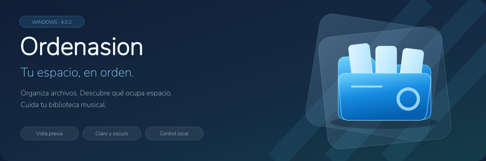
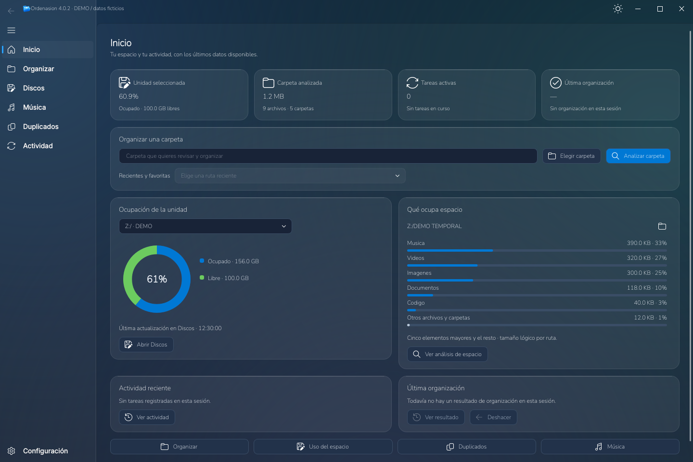
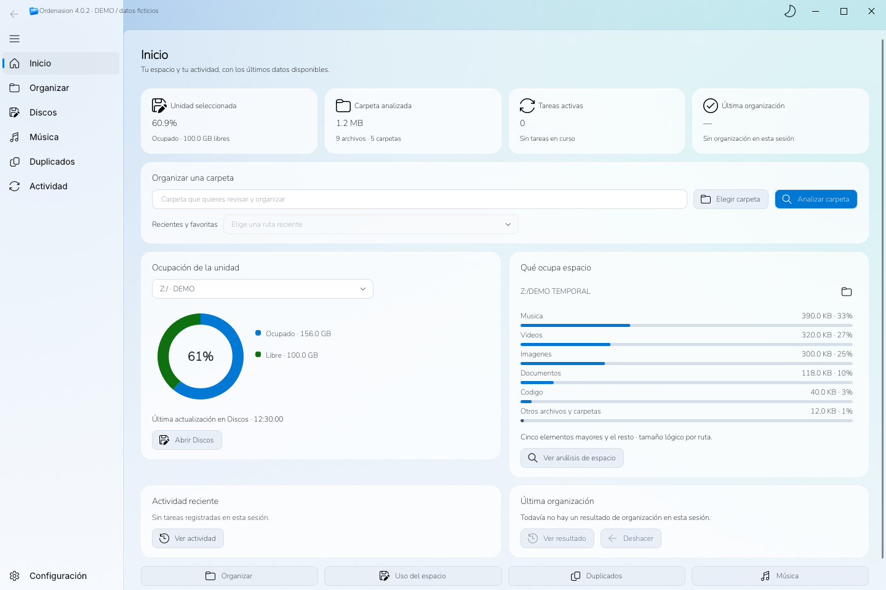
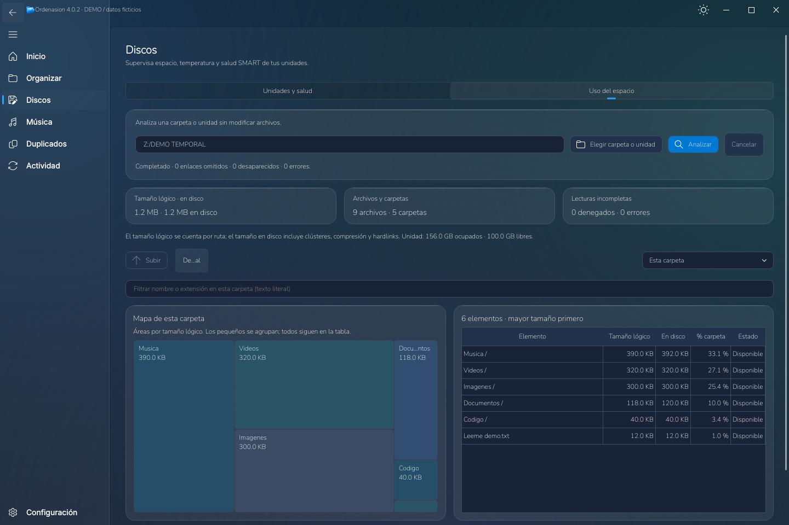
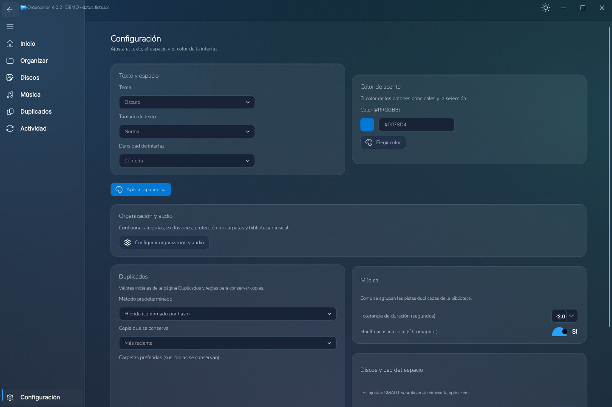

<div align="center">



# Ordenasion

**Organiza tus archivos con control. Entiende tu espacio. Cuida tu música.**


[](LICENSE)

[**⬇ Descargar la última versión**](https://github.com/Kristianesp/Ordenasion/releases/latest) · [Changelog](CHANGELOG.md) · [Código](https://github.com/Kristianesp/Ordenasion/tree/main)

</div>

Aplicación de escritorio para Windows, desarrollada con Python y PyQt6. Reúne organización de archivos, análisis del espacio, duplicados y biblioteca musical en una interfaz **Fluent Ocean Frost**, con temas claro y oscuro.

## 📸 Un vistazo

**Inicio · tema oscuro**



<table>
  <tr>
    <td width="50%"><strong>☀️ Inicio · tema claro</strong><br><a href="docs/images/inicio-claro.png"></a></td>
    <td width="50%"><strong>🗺️ Uso del espacio</strong><br><a href="docs/images/uso-del-espacio.png"></a></td>
  </tr>
</table>

<details>
<summary><strong>🎨 Ver configuración de apariencia</strong></summary>



</details>

*Capturas de la interfaz real 4.0.0, renderizadas con Qt. Archivos temporales y ocupación ficticia, señalados como DEMO; no representan datos del usuario. Pulsa las miniaturas para ampliarlas.*

## ✨ Qué puedes hacer

| Herramienta | Para qué sirve |
| :--- | :--- |
| 📂 **Organizar** | Clasifica por categorías y, opcionalmente, por fecha. Revisa la selección y los destinos antes de confirmar. |
| 🗺️ **Uso del espacio** | Explora tamaños con mapa y tabla, navega por carpetas, filtra y consulta los elementos mayores. |
| 💽 **Discos** | Consulta ocupación y salud SMART, con historial y alertas cuando aumentan los sectores defectuosos. |
| 🎵 **Música** | Indexa tu biblioteca, reproduce audio, compara copias y edita metadatos. |
| 🔎 **Duplicados** | Confirma copias por contenido, elige qué conservar con reglas, sustituye copias por hardlinks y encuentra imágenes parecidas. |
| ⚙️ **Configuración y actividad** | Ajusta apariencia, categorías y exclusiones; sigue tareas, resultados y el registro de la sesión. |

**Tú decides qué se mueve.** La organización incluye vista previa y resolución de conflictos: conservar ambos, sobrescribir u omitir. Cada organización queda en el historial de Actividad y se puede deshacer, también después de cerrar la aplicación. El análisis del espacio es manual y no modifica archivos.

## 🚀 Novedades de 4.0.2

Si algo falla, Ordenasion ya no se cierra en silencio: muestra el error y, si la sesión anterior terminó de golpe, ofrece abrir el informe. La organización completa se prueba ahora en Windows real antes de cada versión.

## 🚀 Novedades de 4.0.1

El ejecutable muestra la pantalla de carga al instante y siempre termina abriendo la ventana. Además, se publica una versión **portable (`.zip`)** que arranca mucho más rápido. Si algo falla, el registro queda en `%LOCALAPPDATA%\Ordenasion\logs`.

## 🚀 Novedades de 4.0.0

1. **Organizar, nativo y seguro:** página Fluent nativa; deshacer persistente con historial en Actividad; «por fecha», cancelar, perfiles y reorganizar corregidos.
2. **Duplicados fiables:** confirmación por hash por defecto, nunca se retiran todas las copias; reglas para conservar, hardlinks, imágenes parecidas y exportación a CSV.
3. **Salud SMART correcta:** cada unidad con su disco real, discos con fallos detectados, historial con alertas y reintento como administrador.
4. **Más rápida:** la ventana se construye en ~0,6 s (antes ~1,75 s), el cambio de tema es casi instantáneo y las páginas pesadas se cargan al abrirlas.
5. **Más cómoda:** atajos con ayuda (F1), tema «Sistema», arrastrar carpetas, aviso al terminar tareas y «Abrir en el Explorador».

Tus datos (configuración, cachés e historial) se guardan ahora en `%LOCALAPPDATA%\Ordenasion`; al arrancar la 4.0 se copian automáticamente desde la ubicación anterior. Consulta el [changelog completo](CHANGELOG.md).

## ▶️ Empezar

### Con el ejecutable

Descarga de la [última versión publicada](https://github.com/Kristianesp/Ordenasion/releases/latest) el `.exe` (un solo archivo) o el `_portable.zip` (descomprímelo y abre el `.exe` de dentro: arranca más rápido) y ábrelo en Windows; no necesitas instalar Python. Elige una carpeta, analiza y revisa los movimientos antes de confirmar.

### Desde el código

En Windows, con Git y Python 3.12 x64:

```powershell
git clone https://github.com/Kristianesp/Ordenasion.git
cd Ordenasion
py -3.12 -m venv venv
.\venv\Scripts\python.exe -m pip install -r requirements.txt
.\arrancar_ordenasion.bat
```

El BAT utiliza el entorno virtual local. `arrancar_ordenasion.bat --comprobar` verifica el punto de entrada y las dependencias sin abrir la aplicación. También puedes iniciar directamente con `venv\Scripts\python.exe main_fluent.py`.

### Compilar y verificar

La [guía de compilación](GUIA_COMPILACION_EXE.md) y la [guía de release](releases_tags_creacion_exes.md) explican las dependencias de build, la spec de PyInstaller y el smoke aislado. El paquete esperado es `Ordenasion_v4.0.2.exe`.

Las [pruebas](tests) cubren organización y deshacer, duplicados, SMART, espacio, temas, audio y empaquetado, y se ejecutan en GitHub Actions en cada push. Para ejecutarlas en el entorno de desarrollo:

```powershell
.\venv\Scripts\python.exe -m pip install pytest
.\venv\Scripts\python.exe -m pytest -q
```

## 📄 Licencia

Código distribuido bajo **GNU GPL v3**, según [LICENSE](LICENSE). Las fuentes Nunito incluyen su [licencia OFL](assets/fonts/OFL.txt); las dependencias y herramientas conservan sus respectivas licencias.
